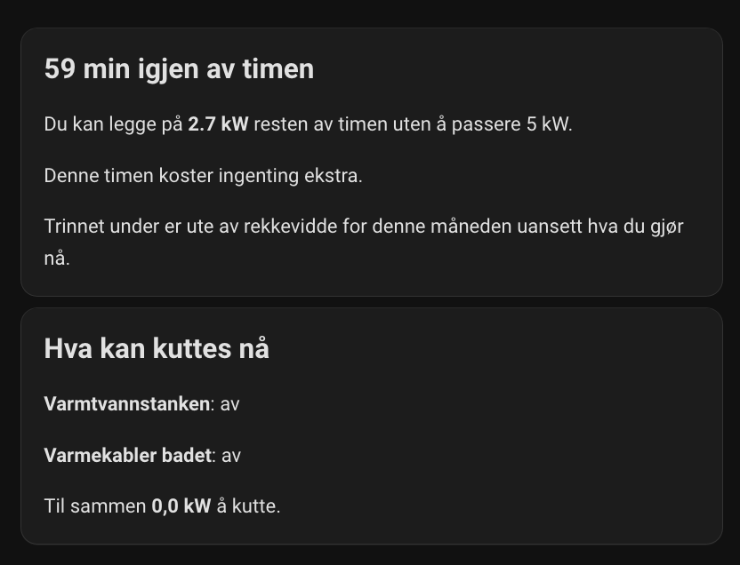
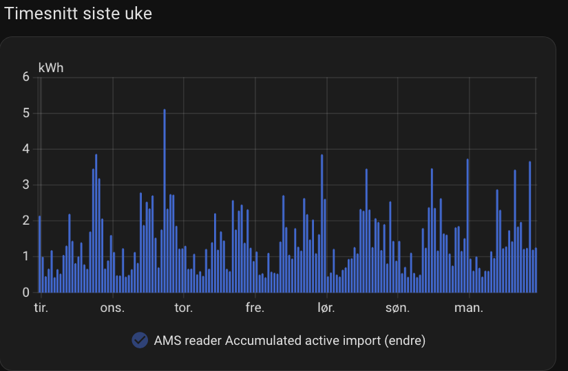

# Effektvakt

[Norsk](README.md) · English

<p align="center">
  <a href="https://github.com/hacs/integration"></a>
  <a href="https://github.com/fredrik-lindseth/hacs-effektvakt/releases/latest"></a>
  <a href="https://github.com/fredrik-lindseth/hacs-effektvakt/actions/workflows/ci.yml"></a>
  <a href="https://github.com/fredrik-lindseth/hacs-effektvakt/actions/workflows/validate.yml"></a>
  <a href="https://app.codecov.io/gh/fredrik-lindseth/hacs-effektvakt"></a>
</p>

Effektvakt projects your average consumption for the current hour and warns when it could push you into a more expensive grid capacity tier. It is a Home Assistant integration for electricity customers in Norway.

<p align="center">
  
</p>

## How it works

Most Norwegian grid companies calculate their monthly capacity charge from the average of the three highest hourly averages, taken from three different days. If one hour raises that three-day average above the next threshold, the higher tier applies to the entire month.

An hour matching an already recorded daily peak does not increase that peak or the capacity charge.

Effektvakt reads your power and energy sensors every 15–60 seconds and projects the hourly average using the energy already consumed and your current power draw. The margin to the next tier accounts for the other peak days already recorded this month. Risk levels use hysteresis so brief fluctuations do not repeatedly switch loads off and on.

Only this top-three method is supported. Sør Aurdal Energi (monthly maximum) and Tinfos (unverified method) are blocked from providing control advice; see the [tariff basis](docs/dso.md). Missing power readings or readings older than two minutes produce unknown advice. Hour boundaries use UTC, keeping the two autumn daylight-saving 02:00 hours separate.

Effektvakt handles notifications and load control to reduce consumption and costs. Today's features address capacity; Nord Pool price scheduling has not been implemented. [Strømkalkulator](https://github.com/fredrik-lindseth/hacs-strømkalkulator) calculates grid charges, taxes and support schemes. Avoiding a capacity tier saves money and does not by itself mean fewer kWh.

Built-in tables use household tariffs. If a holiday home has a different tariff, enter the grid company's top-three capacity tiers as custom tiers.

## Features

- Sensors for projected hourly average, margin to the next tier and monthly top-three average
- Risk levels and a binary sensor that automations can trigger on
- Available load reduction estimated from the loads you configure
- Four blueprints for water heaters, space heaters and notifications
- Persisted responsibility for restoring loads and minimum on-time across automation reloads and HA restarts; unavailable loads are retried when they respond again
- A Lovelace card whose dial uses your selected capacity tiers
- A watchdog that marks sensors as `unknown` if coordinator updates stop

The setup, entities and card support Norwegian and English. Detailed documentation linked below is currently in Norwegian.

## Installation

Requires Home Assistant 2025.1.0 or newer.

### HACS

1. In HACS, open the menu and choose **Custom repositories**.
2. Add `https://github.com/fredrik-lindseth/hacs-effektvakt` with type **Integration**.
3. Download **Effektvakt** and restart Home Assistant.

### Manual installation

Download `effektvakt.zip` from the [latest release](https://github.com/fredrik-lindseth/hacs-effektvakt/releases/latest) and extract it into `/config/custom_components/effektvakt`. Restart Home Assistant.

Then go to **Settings > Devices & Services > Add Integration > Effektvakt**. Choose your grid company and power sensor; the remaining settings have defaults. See the [setup guide](docs/oppsett.md).

## Dashboard

The included Lovelace card recreates the analogue demand monitors once used in Norwegian fuse boxes. It draws the dial from your capacity tiers, so the monthly prices match the tariff you selected.

<p align="center">
  
</p>

The red indicator shows the projected hourly average, the thin black indicator shows current power, and the triangle outside the dial shows the monthly top-three average. Completed peaks remain part of this month's tariff basis.

The neighbouring cards show the remaining minutes, how much load can be added and the reduction needed now:

<p align="center">
  
</p>

The weekly chart shows recorded hourly averages:

<p align="center">
  
</p>

See the [dashboard card guide](docs/dashboard-kort.md) for setup, styles and the dial indicators. The screenshots show the Norwegian interface; card labels follow Home Assistant's language setting.

## Quality and development

CI runs the same checks available locally:

```bash
just test
just test-ha target=minimum
just test-ha target=current
just coverage
```

`just test` runs unit tests, lint, formatting checks, mypy and vulture. Real Home Assistant is tested on both the promised minimum and the current tested version. `just coverage` combines unit and real-HA tests and requires at least 95% combined line coverage. Both coverage reports are uploaded to [Codecov](https://app.codecov.io/gh/fredrik-lindseth/hacs-effektvakt); the badge above displays the service's available report. HACS validation and hassfest also run in CI. See the [development guide](docs/development.md) for environments and commands.

## Documentation

| Document | Contents |
| --- | --- |
| [Setup](docs/oppsett.md) | Configuration step by step |
| [Sensors](docs/sensorer.md) | Sensors and attributes |
| [Calculations](docs/beregninger.md) | Formulas and calculation logic |
| [Input sensors](docs/input-sensorer.md) | Sensor requirements and known sources |
| [Loads](docs/laster.md) | Controllable loads and thresholds |
| [Blueprints](docs/blueprints.md) | Import, inputs and examples |
| [Dashboard card](docs/dashboard-kort.md) | Lovelace card |
| [Physical panel](docs/fysisk-panel.md) | ESP32 panel concept, not built |
| [Limitations](docs/begrensninger.md) | Known limitations |
| [DSO data](docs/dso.md) | Tariff data and updates |
| [Development](docs/development.md) | Developer guide |
| [FAQ](docs/faq.md) | Frequently asked questions |

## License

MIT. See [LICENSE](LICENSE).
