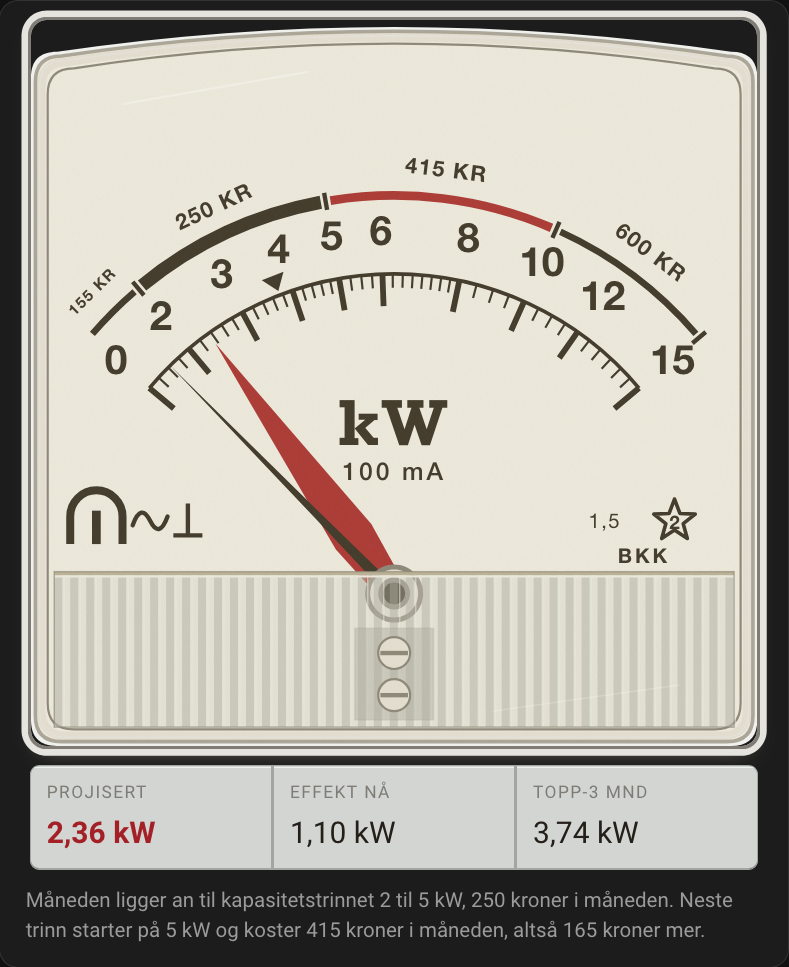
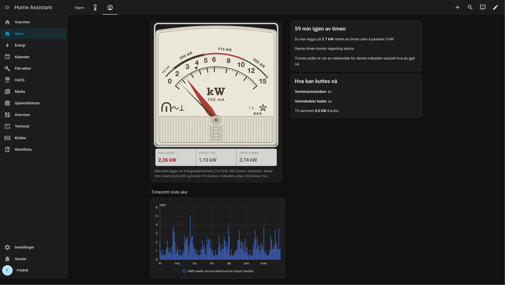

# Effektvakt

Norsk · [English](README.en.md)

  
  
  
  
  

Effektvakt regner ut hvor høyt time-snittet ditt ender, og sier fra i tide hvis timen er på vei til å dytte deg opp i et dyrere kapasitetstrinn i nettleien. Integrasjon for Home Assistant, laget for norske strømkunder.

## Hva kan du spare?

Hos BKK gir ett lavere kapasitetstrinn fra 5–10 til 2–5 kW **165 kr mindre nettleie per måned**. To til fire slike måneder gir 330–660 kr/år; fem gir 825 kr. Elbil, bereder og oppvarming gir fleksibilitet til å flytte toppene.

Dette er betinget potensial. I et eksempelhus med 16 000 kWh/år tilsvarer 330–660 kr omtrent 2–4 % av samlet kraftkostnad og nettleie. Se [årsregnestykket og forutsetningene](docs/sparepotensial.md#hva-kan-det-bli-på-et-år).

## Et regneeksempel fra BKK

1 kW lavere topp-3-snitt ville gitt 330 kr mindre kapasitetsledd over desember 2025 og februar 2026; 600 W ville ikke vært nok. Varighet og gjenoppvarming avgjør om det er mulig. [Historiske tall og simulering](docs/sparepotensial.md).

  

## Hvordan det virker

Sensorene viser projisert timegjennomsnitt, margin, risiko, topp-3-snitt og tilgjengelig kutt. Bruk varsler eller blueprints til å styre laster; lastvernet husker gjeninnkoblingsansvaret gjennom omstart.

Støtter kapasitetstariffer med tre høyeste timer fra ulike dager. Manglende eller gamle målinger gir ukjent råd. Automatisk spotprisplanlegging er ikke implementert. [Strømkalkulator](https://github.com/fredrik-lindseth/hacs-strømkalkulator) beregner nettleie, avgifter og støtteordninger.

Oppsett, sensorer og kort støtter norsk og engelsk. Detaljveiledningene er norske.

## Installasjon

Krever Home Assistant 2025.1.0 eller nyere.

### HACS

Åpne Effektvakt i HACS med knappen. Hvis repoet ikke er lagt til ennå, følg stegene under.

1. Åpne menyen i HACS og velg **Custom repositories**.
2. Legg til `https://github.com/fredrik-lindseth/hacs-effektvakt` med typen **Integration**.
3. Last ned **Effektvakt** og start Home Assistant på nytt.

### Manuell installasjon

Last ned `effektvakt.zip` fra [siste release](https://github.com/fredrik-lindseth/hacs-effektvakt/releases/latest) og pakk den ut i `/config/custom_components/effektvakt`. Start Home Assistant på nytt.

Legg til under **Settings → Devices & Services → Add Integration → Effektvakt**, og velg nettselskap og effektsensor. [Oppsett](docs/oppsett.md).

## Dashbord og laststyring

Legg `custom:effektvakt-card` til i dashbordet. [Kortoppsett og visere](docs/dashboard-kort.md).

  

Registrer [laster](docs/laster.md) under Konfigurer og importer [blueprints](docs/blueprints.md) for varsling eller kutt. Velg tidsgrenser etter lasten; [profiler](docs/lastprofiler.md) anslår bidraget resten av timen.

## Kvalitet og utvikling

CI tester lovet minimum og aktuell Home Assistant-versjon, validerer HACS og hassfest og krever 95 % samlet testdekning. [Codecov](https://app.codecov.io/gh/fredrik-lindseth/hacs-effektvakt) viser rapportene. Miljøer og kommandoer står i [utviklerguiden](docs/development.md).

## Dokumentasjon

| Dokument                                           | Innhold                            |
| -------------------------------------------------- | ---------------------------------- |
| [Sparepotensial](docs/sparepotensial.md) | Månedsmål og historisk simulering |
| [Vask og oppvask i lavpristiden](docs/scenario-nattvask.md) | Forbruk, tidspunkt og nettleie |
| [Norgespris eller spotpris](docs/scenario-norgespris.md) | Prisordninger og høyere Norgespris |
| [Lastprofiler](docs/lastprofiler.md) | Metode, lokal analyse og tolkning |
| [Målerapport](docs/research/lastprofil-rapport.md) | Kunstig eksempel og rapportmal |
| [docs/oppsett.md](docs/oppsett.md)                 | Konfigurasjonsflyten steg for steg |
| [docs/sensorer.md](docs/sensorer.md)               | Alle sensorer og attributter       |
| [docs/beregninger.md](docs/beregninger.md)         | Formler og beregningslogikk        |
| [docs/input-sensorer.md](docs/input-sensorer.md)   | Sensorkrav og kjente kilder        |
| [docs/laster.md](docs/laster.md)                   | Kuttbare laster og terskler        |
| [docs/blueprints.md](docs/blueprints.md)           | Import, input og eksempler         |
| [docs/dashboard-kort.md](docs/dashboard-kort.md)   | Lovelace-kortet                    |
| [docs/fysisk-panel.md](docs/fysisk-panel.md)       | ESP32-panel, skisse (ikke bygget)  |
| [docs/begrensninger.md](docs/begrensninger.md)     | Kjente begrensninger               |
| [docs/dso.md](docs/dso.md)                         | DSO-data og oppdatering            |
| [docs/development.md](docs/development.md)         | Utvikler-guide                     |
| [docs/faq.md](docs/faq.md)                         | Ofte stilte spørsmål               |

## Lisens

MIT. Se [LICENSE](LICENSE).
